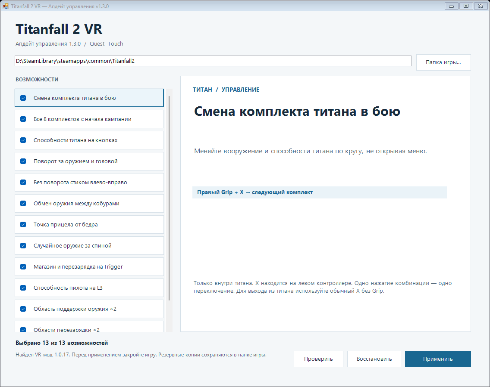
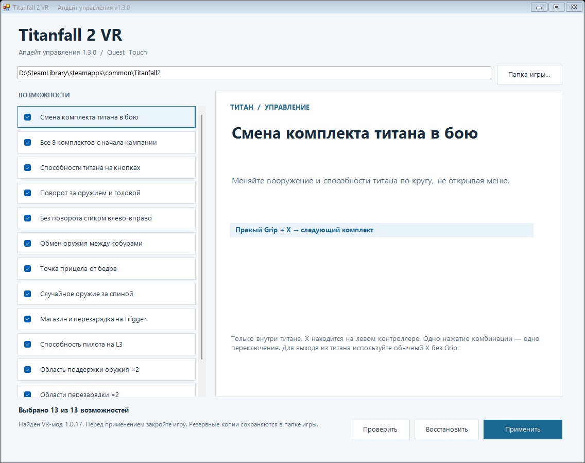

# Titanfall 2 VR — Апдейт управления v1.3.0

Неофициальный патчер для Windows для VR-мода Titanfall 2 от CircuitLord. Слева — выбор возможностей, справа — описание и сочетания кнопок.

[Скачать EXE или ZIP](https://github.com/vikaquest/TitanFall2_VR_mode_improved/releases/latest) · [English edition](https://github.com/vikaquest/Titanfall2-VR-Controls-Update-EN)

Анимация выбирает следующий пункт раз в секунду. Это настоящее окно программы, не запись игрового процесса.

Обычный скриншот

## Установка

1. Установите Titanfall 2, затем VR-мод через [CircuitLordVRModInstaller](https://github.com/CircuitLord/CircuitLordVRModInstaller).
2. Закройте игру. Скачайте и запустите `Titanfall2VR-QuestPatch.exe`.
3. Выберите папку игры `Titanfall2`. Все опции изначально включены; снимите ненужные. Нажмите на название пункта, чтобы прочитать описание и управление.
4. Нажмите **«Применить»** и запустите VR через оригинальный инсталлятор, как обычно.

Windows 10/11 x64, .NET Framework 4.8, контроллеры Quest / Touch. Для запуска EXE не нужны Python, интернет или отдельная установка патчера.

Новые возможности относятся к проверенной сборке **VR-мода 1.0.17**. Профили **1.0.13 / 1.0.14** сохраняют прежние девять опций и назначения кнопок. Проверяются контрольные суммы файлов, а не только номер версии.

## Возможности и управление

### Смена комплекта титана в бою

Меняйте вооружение и способности титана по кругу, не открывая меню.

- Правый Grip + X → следующий комплект

Только внутри титана. X находится на левом контроллере. Одно нажатие комбинации — одно переключение. Для выхода из титана используйте обычный X без Grip.

### Все 8 комплектов с начала кампании

Добавьте в круг переключения даже те комплекты, которые ещё закрыты по сюжету.

- Правый Grip + X → переключение по кругу
- Expedition · Tone · Scorch · Brute
- Ion · Ronin · Northstar · Legion

Доступны, когда вы управляете титаном. Сам титан в пешей части первой миссии не выдаётся. Замки в меню и сюжетный прогресс сохраняются. Недоступные на уровне ресурсы могут ограничивать выбор.

### Способности титана на кнопках

Зажмите левый Grip и выберите способность кнопкой. Не нужно двигать руку по направлениям стрелок.

- Левый Grip + левый Trigger → способность 1
- Левый Grip + A → способность 2
- Левый Grip + B → способность 3
- Левый Grip + R3 → ядро титана
- Левый Grip + правый Trigger → удар
- R3 без Grip → удар

A и B находятся на правом контроллере. R3 — нажатие правого стика. Способность 1 поддерживает удержание. Для VR 1.0.13 / 1.0.14 сохраняется прежняя схема; новые сочетания относятся к 1.0.17.

### Поворот за оружием и головой

Оружие задаёт 70% направления кабины, голова — 30%. Поворот быстрее, с небольшим доворотом по инерции.

- Оружие — 70%   /   Голова — 30%
- Автодоворот — до 360°/с
- Краткая инерция — до 20°

Также ускоряет переходы защиты мечом и восстановление до 0,1 с. При потере корректной позы оружия управление временно переходит к голове. Если поворот стиком включён, его скорость увеличивается вдвое.

### Без поворота стиком влево-вправо

Отключите искусственный поворот правым стиком у пилота и титана. Поворачивайтесь движениями в VR.

- Правый стик влево / вправо → без поворота

Движения стика вверх-вниз и его нажатие сохраняются. Для управления кабиной титана движениями включите смешанный поворот за оружием и головой.

### Обмен оружия между кобурами

Меняйте местами оружие за спиной и у левого бедра. Оружие остаётся в кобурах, а не достаётся в руки.

- B → поменять оружие местами

Оба оружия убраны, руки пустые, остальные кнопки отпущены. B находится на правом контроллере. С оружием в руках B сохраняет обычную перезарядку.

### Точка прицела от бедра

Видьте направление оружия, не поднося его к глазу и не входя в режим прицеливания.

- Белая заполненная точка
- Отображается с оружием в руках у пилота

Это указатель направления оружия. Он не отображает разброс или предсказанную траекторию. Для гранат и титана точка не показывается.

### Случайное оружие за спиной

Заменяйте оружие за спиной случайным. Оружие у левого бедра остаётся прежним.

- Правый Trigger + B → случайное оружие
- Для повторной замены снова нажмите B

Оба оружия должны быть убраны, руки — пустыми. Выбор из 31 типа зависит от ресурсов уровня; имеющиеся типы исключаются. Требует включённого обмена оружия между кобурами.

### Магазин и перезарядка на Trigger

Берите магазин и управляйте ручной перезарядкой левым курком. Grip остаётся для хвата оружия.

- Левый Trigger → магазин и перезарядка

Автоматически включает перенос способности пилота на L3, чтобы освободить левый Trigger.

### Способность пилота на L3

Активируйте cloak или текущую способность пилота нажатием левого стика.

- L3 → способность пилота

Работает вне титана. L3 — нажатие левого стика. Освобождает левый Trigger для перезарядки.

### Область поддержки оружия ×2

Увеличьте в два раза область, в которой срабатывает хват оружия второй рукой.

- Область хвата второй рукой ×2

Область извлечения оружия правым Grip не меняется.

### Области перезарядки ×2

Увеличьте области магазина и механизмов перезарядки в два раза, чтобы движения требовали меньшей точности.

- Магазин и механизмы перезарядки ×2

Изменяется область взаимодействия, а не скорость анимации перезарядки.

### Граната с груди на правом Trigger

Поднесите руку к груди и нажмите правый курок, чтобы взять обычную гранату.

- Рука у груди + правый Trigger → граната

Опция относится к обычным гранатам. Изменение взятия C4 в неё не входит.

## Копии и изменение выбора

При каждом запуске отмечены все опции, независимо от предыдущего выбора. Проверьте галочки перед применением. Обычное переключение титана и «все восемь» совместимы: вторая опция расширяет доступный круг. Перезарядка на Trigger включает перенос способности пилота; случайное оружие требует обмена кобур.

Файлы каждый раз строятся из проверенной исходной копии, а не наслаивают изменения. Снятие всех опций возвращает поддерживаемые файлы к исходной версии. **«Восстановить»** использует первоначальный журнал. Существующие журналы 1.0.17 и наши текущие ручные изменения поддерживаются.

Копии и журналы лежат внутри игры: `.quest-custom-patch`, `.quest-custom-patch-1.0.14` или `.quest-custom-patch-1.0.17`. Сохраняйте эти папки. Не применяйте старый патчер поверх 1.3.0.

## Исходники и сборка

Здесь опубликованы исходники патчера, а не исходный код оригинального VR-мода.

- `QuestPatch.cs` — окно, установка, проверки и восстановление.
- `features.json` — описания, управление и порядок пунктов.
- `messages.json` — английский перевод сообщений установщика.
- `payload.json` — операции патча DLL, изменения скриптов и контрольные суммы поддерживаемых файлов.
- `build.ps1` — сборка отдельного EXE x64 для .NET Framework.

Запустите `./build.ps1` в Windows. Результат — `dist/Titanfall2VR-QuestPatch.exe`. Оригинальные DLL игры и полные оригинальные игровые скрипты не распространяются. Русская и английская версии используют одинаковые рецепты изменений и формат копий; отличаются тексты интерфейса и язык сборки.

## Проверка и ограничения

См. [VERIFICATION.md](VERIFICATION.md). На отдельных копиях проверены 8192 комбинации возможностей, применение/восстановление и переход с текущих ручных изменений. Проверены зависимости галочек, обе языковые сборки и GIF из 13 кадров. Эти проверки не заменяют игру в VR-шлеме.

Ресурсы уровня и состояние сохранения могут ограничивать выбор комплектов и случайного оружия. Взятие C4, два оружия одновременно, прототип подката, поздняя загрузка через консоль сервера, автоматический сброс позиции при посадке и косметическое исправление оружия при выходе не включены. Точка не показывает разброс пуль.

## Благодарности

Оригинальный VR-мод Titanfall 2 и инсталлятор созданы [CircuitLord](https://github.com/CircuitLord/CircuitLordVRModInstaller). Это отдельное неофициальное дополнение для кампании, не официальный релиз CircuitLord.
